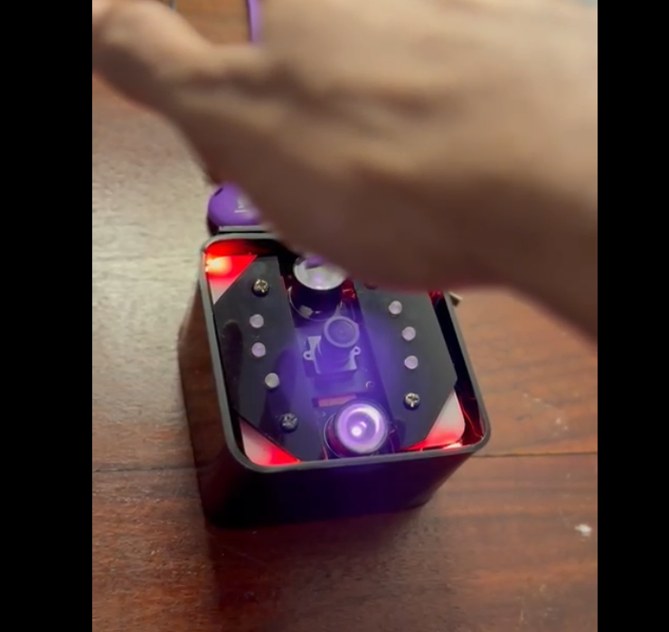
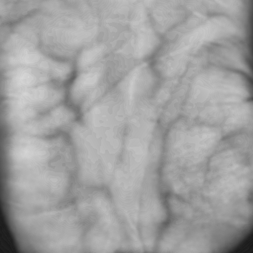
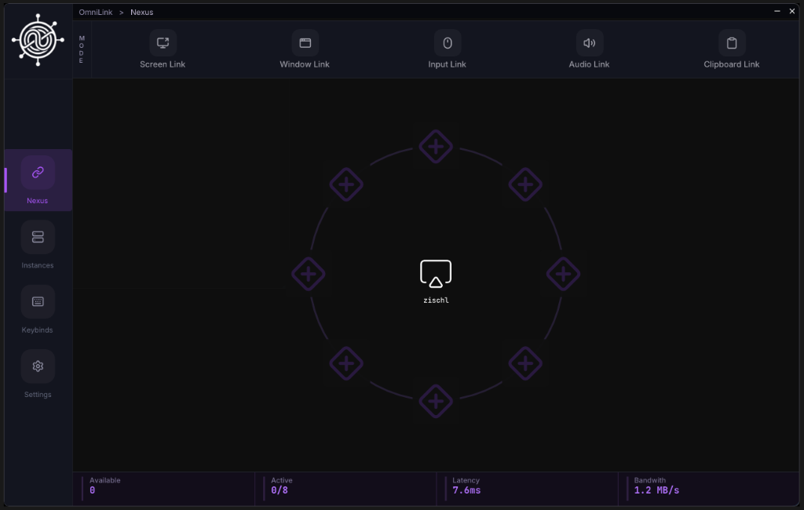

<h1 align="center">Nidula Weerasinghe</h1>

  <strong>Low-Level Systems &nbsp;·&nbsp; Robotics, Embedded &amp; IoT &nbsp;·&nbsp; High-Performance Computing</strong> 
  Galle, Sri Lanka &nbsp;•&nbsp; 
  <a href="https://linkedin.com/in/nidula-weerasinghe">LinkedIn</a> &nbsp;•&nbsp; 
  <a href="https://github.com/zischl">GitHub</a> &nbsp;•&nbsp; 
  <a href="mailto:nullspacez6@gmail.com">nullspacez6@gmail.com</a>

  <code>C++ (14/17/20)</code> &nbsp;•&nbsp; 
  <code>Rust</code> &nbsp;•&nbsp; 
  <code>Go</code> &nbsp;•&nbsp; 
  <code>Python</code> &nbsp;•&nbsp; 
  <code>TypeScript</code> &nbsp;•&nbsp; 
  <code>Java</code> &nbsp;•&nbsp; 
  <code>Lua</code> 
  <code>Direct3D 11</code> &nbsp;•&nbsp; 
  <code>Vulkan</code> &nbsp;•&nbsp; 
  <code>CUDA</code> &nbsp;•&nbsp; 
  <code>React</code>

  <em>CS undergraduate at University of Westminster / IIT building performance-critical software - from zero-copy GPU pipelines to bare-metal PCB hardware, specializing in C++.</em>

---

## Featured Systems

### 1. Z-TAS - Zero Touch Authentication System
> High-assurance, multimodal contactless biometric access control combining simultaneous palm vein and palmprint recognition with hardware-isolated cryptographic verification.  
> `C++` • `Rust` • `Go` • `OpenCV` • `GStreamer` • `Kata Containers` • `Redis` • `PostgreSQL` &nbsp;|&nbsp; *Hult Prize Finalist*

  
  &nbsp;&nbsp;
   
  <b>Left: Active Terminal with Hand Proximity &amp; Cross-Polarized NIR Illumination &nbsp;·&nbsp; Right: Raw Infrared Subdermal Vein Capture</b>

- **Simultaneous Palmprint &amp; Palm Vein Fusion:** Captures surface epidermal ridges and internal vascular networks in parallel, creating an internal physiological profile immune to spoofing.
- **Custom Cross-Polarized Optics:** Modified Raspberry Pi camera module with IR-cut filter removed, linear polarizing films, and Time-of-Flight distance sensing to eliminate specular glare and ambient lighting noise.
- **MicroVM-Sandboxed Rust Enclave:** Biometric template matching and AES-256-GCM authenticated encryption (DEK/KEK with AAD) isolated inside Kata Containers for hardware-level memory sandboxing.
- **Distributed Fleet Mesh &amp; Passwordless Admin:** Central Go gRPC orchestrator managing edge terminals, backed by Redis for sub-millisecond 2FA session states and FIDO2/WebAuthn Passkeys for administrative security.

---

### 2. OmniLink - Cross-Platform LAN Workspace Unification Engine
> Turns multiple standalone PCs on the same LAN into one unified workstation with zero perceived lag.  
> `C++` • `Direct3D 11 / CUDA` • `Windows IOCP` • `WASAPI` • `Monocypher` &nbsp;|&nbsp; [Source Code →](https://github.com/zischl/OmniLink)

   
  <b>OmniLink Real-Time Control Center &amp; Radial Node Topology</b>

- **Seamless Peripheral Sharing:** Flow mouse and keyboard across independent machines with sub-millisecond input response, automatic coordinate scaling, and anti-loopback filtering.
- **Zero-Copy Streaming:** High-framerate desktop and window streaming feeding WGC/DXGI surfaces directly into NVENC and CUDA in-VRAM kernels, bypassing DWM compositor latency with tearing swapchains.
- **Cross-Machine Window Dragging:** Drag individual application windows across physical screen edges onto neighboring devices using real-time edge triggers and isolated window streaming (`WindowLink`).
- **Virtual Clipboard &amp; Audio Sync:** Lock-free SPSC WASAPI audio streaming with multi-clock drift mitigation, paired with delayed-rendering COM virtualization for multi-gigabyte file transfers.

---

### 3. ZAIR - High-Speed 4WD Vacuum Micromouse
> A high-speed autonomous maze-solving robot engineered for extreme acceleration and cornering grip in the IEEE Micro Maze competition.  
> `KiCad` • `STM32F405` • `Fusion 360` • `Embedded C/C++` &nbsp;|&nbsp; [Source Code →](https://github.com/zischl/ZAIR)

   
  <b>Custom 2-Layer FR4 PCB Serving as Both Electrical System &amp; Structural Vehicle Chassis</b>

  
  &nbsp;&nbsp;
   
  <b>Left: Dual-Drive 3-Gear Direct Pinion Mesh &nbsp;·&nbsp; Right: Motor Mount &amp; Geared Wheels Assembly</b>

- **Active Vacuum Downforce:** A central 40,000 RPM impeller sucks the robot to the maze floor, generating massive negative pressure for high-G turns without slipping.
- **Structural PCB Chassis:** The circuit board itself serves as the robot's physical frame, minimizing weight and packaging all motors, drivers, and sensors directly on the substrate.
- **Sub-Millimeter Wall Tracking:** High-frequency pulsed infrared beams and 14-bit magnetic wheel encoders map maze corridors in real-time at speeds up to 5+ m/s.

---

## Notable Projects

- **[BuildSentry.nvim](https://github.com/zischl/BuildSentry.nvim)** - Neovim build supervisor & floating TUI adapter for `cmake-tools.nvim` with cross-platform toolchain probing. `Lua` `CMake`
- **[AI-Commits.nvim](https://github.com/zischl/AI-Commits.nvim)** - Conventional commit generator for Neovim with an async pure-Lua SSE stream parser for LLM diff analysis. `Lua` `Gemini API`
- **[Cross-GLDX](https://github.com/zischl/Cross-GLDX)** - High-performance C++ graphics wrapper enabling zero-copy texture sharing between OpenGL and Direct3D 11. `C++` `D3D11` `OpenGL`
- **Flood-Watch** - Autonomous ESP32 flood-warning unit with ultrasonic velocity detection and serial-to-FastAPI telemetry. `C++` `ESP32` `FastAPI`

---

## Honors

- **1st Runner-Up** - Hult Prize IIT (2026)
- **1st Runner-Up** - VERTEX IoT Competition (December 2025)
- **Gold Medal** - Ruhuna New Inventions Exhibition

---

  Engineered by <b>Nidula Weerasinghe</b> (<a href="https://github.com/zischl">@zischl</a>)

